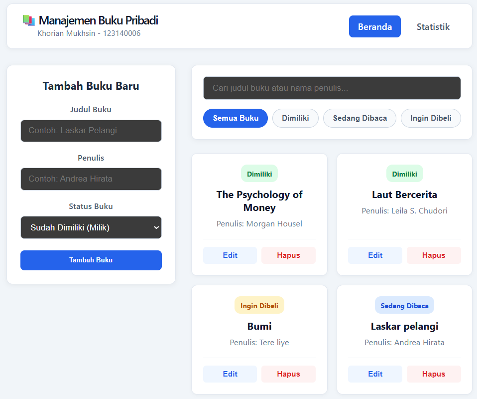
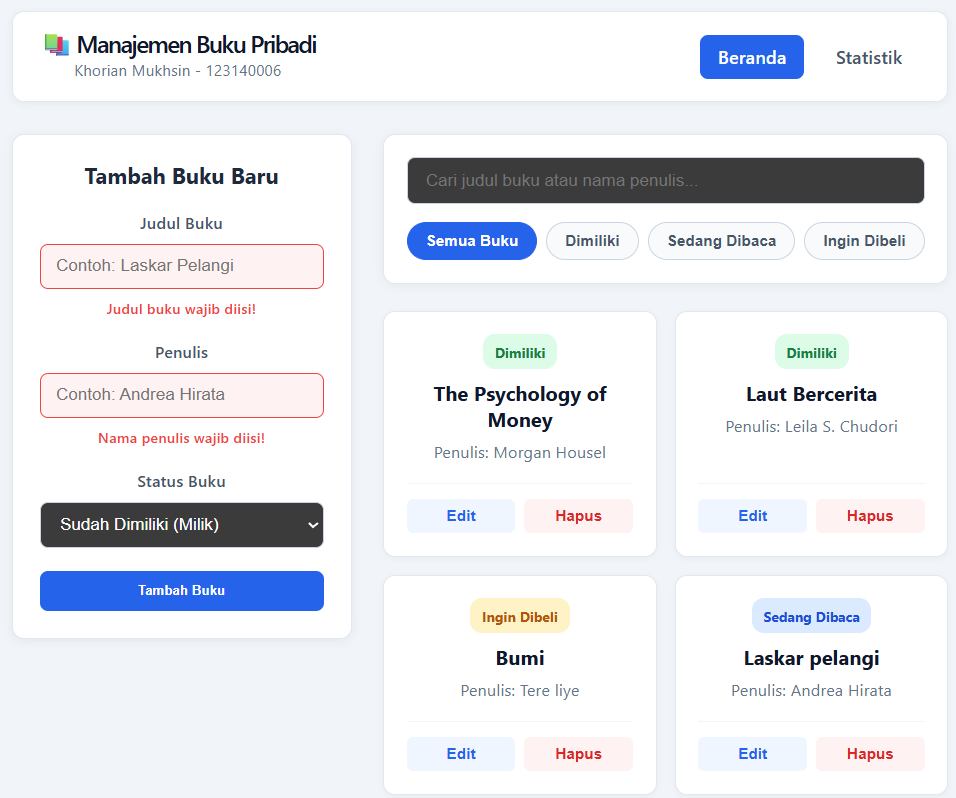
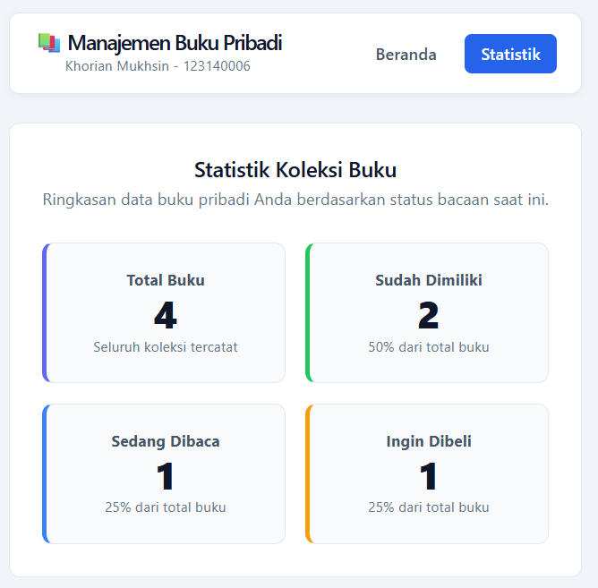
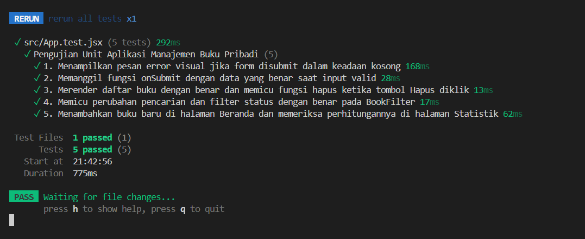

# 📚 Aplikasi Manajemen Buku Pribadi

**Nama:** Khorian Mukhsin  
**NIM:** 123140006  
**Program Studi:** Teknik Informatika - Institut Teknologi Sumatera  
**Tugas:** Praktikum pertemuan 3 - Pengembangan Aplikasi Web (React)

---

## 📖 Deskripsi Aplikasi

**Aplikasi Manajemen Buku Pribadi** adalah aplikasi web berbasis **React (Vite)** yang membantu pengguna mencatat, mengorganisir, dan memantau koleksi buku pribadi mereka secara efisien. Pengguna dapat mengelompokkan buku ke dalam tiga kategori status:
- **Sudah Dimiliki (`milik`)**: Buku yang sudah ada di koleksi pribadi.
- **Sedang Dibaca (`baca`)**: Buku yang saat ini sedang dalam proses dibaca.
- **Ingin Dibeli (`beli`)**: Daftar keinginan (*wishlist*) buku yang berencana dibeli.

Selain fitur utama **CRUD (Create, Read, Update, Delete)**, aplikasi ini dilengkapi dengan pencarian instan (*real-time search*) berdasarkan judul maupun penulis, filter berdasarkan status buku, validasi form dengan umpan balik visual, halaman ringkasan statistik, serta penyimpanan persisten menggunakan `localStorage`.

---

## 📂 Struktur Folder Project

```text
Khorian_123140006_pertemuan3/
├── screenshots/
│   ├── home.png
│   ├── error-validation.png
│   ├── stats.png
│   └── test-result.png
├── src/
│   ├── components/
│   │   ├── BookForm/
│   │   │   ├── BookForm.jsx
│   │   │   └── BookForm.css
│   │   ├── BookList/
│   │   │   ├── BookList.jsx
│   │   │   └── BookList.css
│   │   └── BookFilter/
│   │       ├── BookFilter.jsx
│   │       └── BookFilter.css
│   ├── pages/
│   │   ├── Home/
│   │   │   ├── Home.jsx
│   │   │   └── Home.css
│   │   └── Stats/
│   │       ├── Stats.jsx
│   │       └── Stats.css
│   ├── hooks/
│   │   ├── useLocalStorage.js
│   │   └── useBookStats.js
│   ├── context/
│   │   └── BookContext.jsx
│   ├── App.jsx
│   ├── App.css
│   ├── App.test.jsx
│   └── main.jsx
├── package.json
├── vite.config.js
└── README.md
```

---

## ⚙️ Instruksi Instalasi dan Cara Menjalankan Aplikasi

Pastikan **Node.js** sudah terpasang di perangkat Anda, kemudian ikuti langkah-langkah berikut:

1. **Masuk ke direktori project:**
   ```bash
   cd Khorian_123140006_pertemuan3
   ```

2. **Pasang seluruh dependensi:**
   ```bash
   npm install
   ```

3. **Jalankan server pengembangan (*Development Server*):**
   ```bash
   npm run dev
   ```
   Buka browser dan akses alamat yang muncul di terminal (umumnya `http://localhost:5173`).

4. **Jalankan pengujian unit (*Unit Testing*):**
   ```bash
   npm run test
   ```

---

## ⚛️ Penjelasan Fitur React yang Digunakan

1. **Functional Components & React Hooks (`useState`, `useEffect`, `useMemo`)**:
   - `useState`: Mengelola state input form (`title`, `author`, `status`), pesan error validasi, kata kunci pencarian (`searchQuery`), status filter (`filterStatus`), dan state buku yang sedang diedit (`editingBook`).
   - `useEffect`: Menyinkronkan perubahan data buku ke `localStorage` serta mengisi otomatis (*populate*) kolom form ketika pengguna menekan tombol **Edit** pada salah satu buku.
   - `useMemo`: Mengoptimalkan perhitungan jumlah dan persentase buku berdasarkan status agar tidak dihitung ulang jika daftar buku tidak berubah.

2. **Context API (`src/context/BookContext.jsx`)**:
   - Menyediakan state global melalui `BookProvider` dan custom consumer hook `useBooks()`. Menghindari *prop drilling* при berbagi data buku, fungsi CRUD (`addBook`, `updateBook`, `deleteBook`), serta filter antar halaman `Home` dan `Stats`.

3. **Custom Hooks (`src/hooks/`)**:
   - `useLocalStorage.js`: Custom hook reusable untuk membaca dan menyimpan state secara persisten ke dalam `window.localStorage` dilengkapi blok `try-catch` sebagai *error handling*.
   - `useBookStats.js`: Custom hook untuk mengkalkulasi total buku, rincian jumlah per status (`milik`, `baca`, `beli`), dan persentase masing-masing kategori.

4. **3 Komponen Reusable (`src/components/`)**:
   - `BookForm`: Komponen form untuk menambah dan mengedit buku dilengkapi validasi input wajib isi dan tampilan pesan error.
   - `BookFilter`: Komponen pencarian teks (judul/penulis) dan tab tombol filter status buku.
   - `BookList`: Komponen untuk menampilkan daftar kartu buku, lencana (*badge*) status, serta tombol aksi Edit dan Hapus.

5. **React Router (`react-router-dom`)**:
   - Mengimplementasikan navigasi *Single Page Application (SPA)* multi-halaman antara halaman **Beranda (`/`)** dan halaman **Statistik (`/stats`)** menggunakan `BrowserRouter`, `Routes`, `Route`, dan `NavLink`.

6. **PropTypes Type Checking (`prop-types`)**:
   - Memvalidasi tipe data seluruh props yang dikirimkan ke komponen `BookForm`, `BookList`, `BookFilter`, dan `BookProvider` untuk mencegah bug tipe data.

---

## 🖼️ Screenshot Antarmuka Aplikasi

### 1. Halaman Beranda (Daftar Buku, Pencarian, & Filter)


### 2. Validasi Error Handling pada Form Input


### 3. Halaman Statistik Buku


---

## 🧪 Laporan Testing (Vitest & React Testing Library)

Pengujian unit dan integrasi dilakukan menggunakan **Vitest**, **React Testing Library**, dan **jsdom** pada file `src/App.test.jsx` yang mencakup **5 skenario pengujian**:

1. **Test 1 (Error Handling & Validasi Form):** Memastikan pesan error visual (`"Judul buku wajib diisi!"` dan `"Nama penulis wajib diisi!"`) muncul ketika form disubmit dalam keadaan kosong dan mencegah pemanggilan fungsi submit.
2. **Test 2 (Input Form Valid):** Memastikan komponen `BookForm` memanggil fungsi `onSubmit` dengan objek data `{ title, author, status }` yang tepat ketika seluruh input diisi dengan benar.
3. **Test 3 (Render & Hapus Buku):** Memastikan `BookList` merender informasi buku dengan akurat dan memicu fungsi `onDelete` dengan ID buku yang sesuai saat tombol Hapus diklik.
4. **Test 4 (Filter & Pencarian):** Memastikan perubahan input pencarian dan klik tombol filter kategori pada `BookFilter` memicu *callback* perubahan state dengan benar.
5. **Test 5 (Integrasi Halaman Beranda & Statistik):** Memastikan penambahan buku baru di halaman Beranda langsung tersimpan dan memperbarui kalkulasi persentase pada halaman Statistik.

### Hasil Eksekusi Terminal (`npm run test`):
```text
 ✓ src/App.test.jsx (5 tests) 292ms
   ✓ Pengujian Unit Aplikasi Manajemen Buku Pribadi (5)
     ✓ 1. Menampilkan pesan error visual jika form disubmit dalam keadaan kosong 168ms
     ✓ 2. Memanggil fungsi onSubmit dengan data yang benar saat input valid 28ms
     ✓ 3. Merender daftar buku dengan benar dan memicu fungsi hapus ketika tombol Hapus diklik 13ms
     ✓ 4. Memicu perubahan pencarian dan filter status dengan benar pada BookFilter 17ms
     ✓ 5. Menambahkan buku baru di halaman Beranda dan memeriksa perhitungannya di halaman Statistik 62ms

 Test Files  1 passed (1)
      Tests  5 passed (5)
```

### Screenshot Hasil Testing di Terminal:
