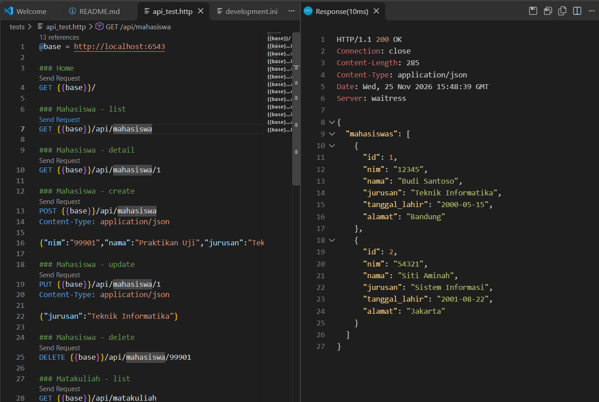
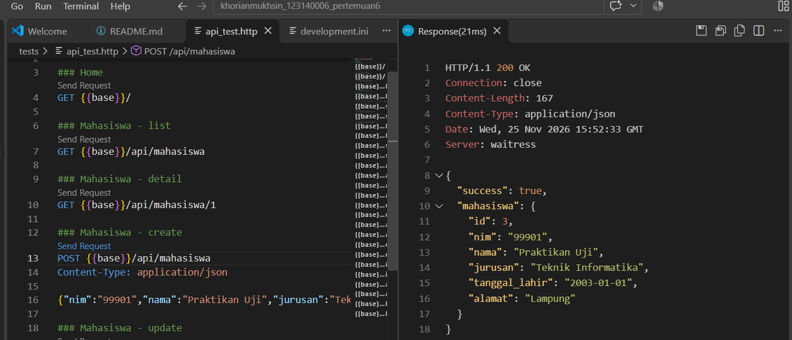
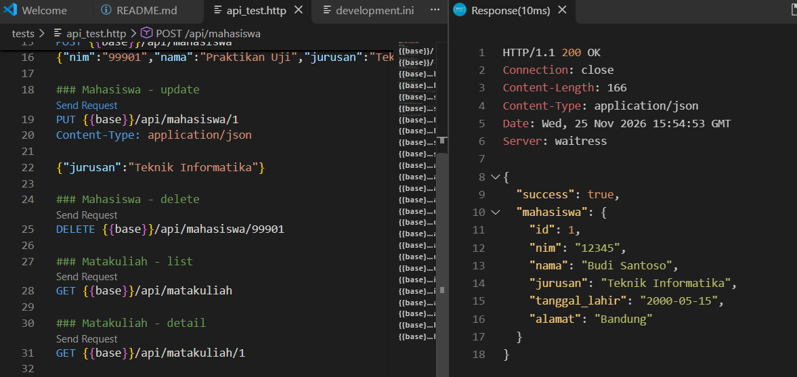
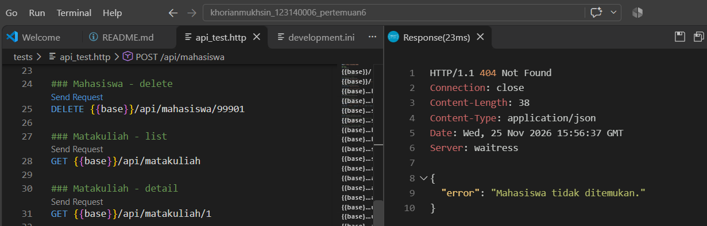

# Praktikum Pengembangan Aplikasi Web — Pertemuan 6
## RESTful API Pyramid + PostgreSQL (Mahasiswa & Matakuliah)


- Nama: **Khorian Mukhsin**
- NIM: **123140006**
- Kelas praktikum: **RB**

### Fitur
- Pyramid URL Dispatch dengan `request_method`
- SQLAlchemy ORM dan PostgreSQL
- Alembic migrations
- Data seed Mahasiswa dan Matakuliah
- CRUD JSON API untuk dua resource
- Validasi input, duplikasi NIM/kode MK, dan status 400/404

### 1. Persiapan (Windows PowerShell)
Pastikan Python 3.10/3.11 (atau versi kompatibel dengan paket), PostgreSQL dan `psql` sudah terpasang serta service PostgreSQL berjalan.

```powershell
# dari folder project ini
python -m venv venv
.env\Scripts\Activate.ps1
python -m pip install --upgrade pip setuptools
pip install -e ".[testing]"
```
Jika PowerShell menolak aktivasi, jalankan sekali sebagai pengguna biasa:
```powershell
Set-ExecutionPolicy -ExecutionPolicy RemoteSigned -Scope CurrentUser
```
Lalu aktifkan kembali venv.

### 2. Buat database PostgreSQL
Masuk ke psql sebagai superuser PostgreSQL (sesuaikan nama superuser jika berbeda):
```sql
CREATE DATABASE pyramid_mahasiswa;
CREATE USER pyramid_user WITH ENCRYPTED PASSWORD 'pyramid_pass';
GRANT ALL PRIVILEGES ON DATABASE pyramid_mahasiswa TO pyramid_user;
\c pyramid_mahasiswa
GRANT ALL ON SCHEMA public TO pyramid_user;
```
Connection string lokal ada di `development.ini`. **Ganti username/password/host/port jika konfigurasi PostgreSQL kamu berbeda.** Jangan unggah password asli ke repositori publik.

Uji koneksi:
```powershell
psql -h localhost -U pyramid_user -d pyramid_mahasiswa
```

### 3. Migrasi & data awal
Jalankan dari folder yang berisi `development.ini`, dengan venv aktif:
```powershell
alembic -c development.ini upgrade head
python -m pyramid_mahasiswa.scripts.initialize_db development.ini
```
Skrip seed aman dijalankan berulang: record dengan NIM/kode MK yang sudah ada tidak ditambahkan lagi.

### 4. Jalankan server
```powershell
pserve development.ini --reload
```
Server default: `http://localhost:6543`

### 5. Endpoint
| Method | URL | Fungsi |
|---|---|---|
| GET | `/api/mahasiswa` | Daftar mahasiswa |
| GET | `/api/mahasiswa/{id}` | Detail mahasiswa |
| POST | `/api/mahasiswa` | Tambah mahasiswa |
| PUT | `/api/mahasiswa/{id}` | Ubah mahasiswa |
| DELETE | `/api/mahasiswa/{id}` | Hapus mahasiswa |
| GET | `/api/matakuliah` | Daftar mata kuliah |
| GET | `/api/matakuliah/{id}` | Detail mata kuliah |
| POST | `/api/matakuliah` | Tambah mata kuliah |
| PUT | `/api/matakuliah/{id}` | Ubah mata kuliah |
| DELETE | `/api/matakuliah/{id}` | Hapus mata kuliah |

### 6. Pengujian
File `tests/api_test.http` berisi request untuk VS Code REST Client. Bisa juga pakai Postman/cURL. Untuk melihat status HTTP di PowerShell gunakan Postman atau REST Client, atau `curl.exe -i URL`.

Contoh body Matakuliah POST:
```json
{
  "kode_mk": "IF2110",
  "nama_mk": "Pemrograman Web",
  "sks": 3,
  "semester": 5
}
```
Validasi: semua field wajib; `sks` dan `semester` integer positif; kode MK unik. ID yang tidak ditemukan mengembalikan 404.

### 7. Screenshot laporan
### 1. GET – Menampilkan Seluruh Data Mahasiswa

Endpoint: `GET /api/mahasiswa`

Pengujian ini dilakukan untuk menampilkan seluruh data mahasiswa yang tersimpan di database.



### 2. POST – Menambahkan Data Mahasiswa

Endpoint: `POST /api/mahasiswa`

Pengujian ini dilakukan untuk menambahkan data mahasiswa baru ke dalam database dengan mengirimkan data dalam format JSON.



### 3. PUT – Mengubah Data Mahasiswa

Endpoint: `PUT /api/mahasiswa/{id}`

Pengujian ini dilakukan untuk memperbarui data mahasiswa berdasarkan ID yang ditentukan.



### 4. DELETE – Menghapus Data Mahasiswa

Endpoint: `DELETE /api/mahasiswa/{id}`

Pengujian ini dilakukan untuk menghapus data mahasiswa berdasarkan ID yang ditentukan.



### 8. Git
```powershell
git init
git add .
git commit -m "Praktikum pertemuan 6 Pyramid API"
```
Pastikan `venv/`, file rahasia, cache, dan database lokal tidak masuk Git (`.gitignore` sudah disediakan).
