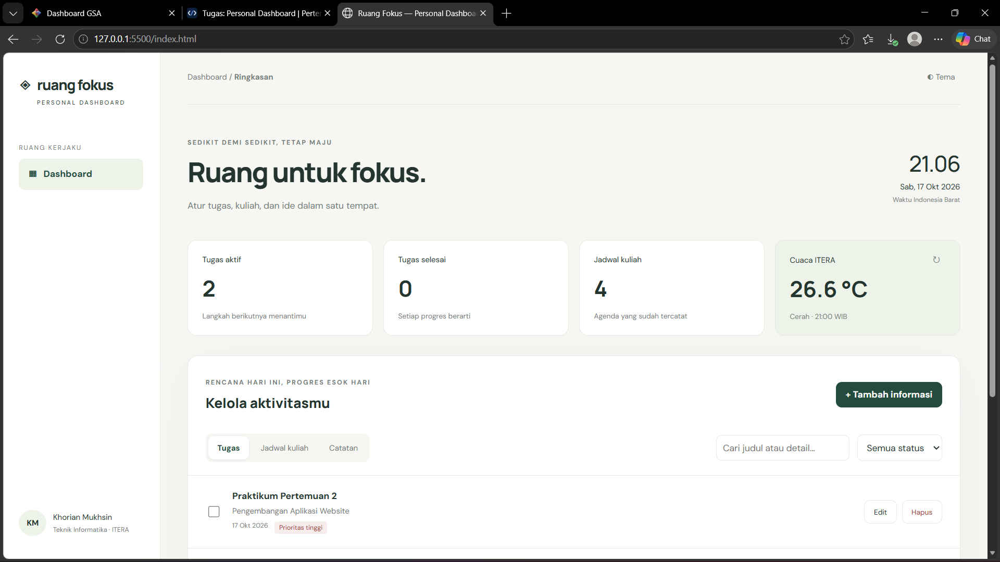

# Ruang Fokus — Personal Dashboard Mahasiswa

**Nama:** Khorian Mukhsin  
**NIM:** 123140006  
**Program studi:** Teknik Informatika, Institut Teknologi Sumatera

## 1. Tujuan dan konsep
Ruang Fokus membantu mahasiswa mengelola deadline praktikum, agenda kuliah, dan catatan dalam satu aplikasi. Aplikasi menggunakan HTML, CSS, dan JavaScript murni tanpa framework, API key, maupun instalasi dependency.

## 3. Tahapan pengerjaan
1. **Analisis kebutuhan:** identifikasi informasi mahasiswa yang perlu dikelola, yaitu tugas, jadwal kuliah, dan catatan. Tentukan field id, kind, title, details, date, time, priority, dan done.
2. **Struktur HTML:** susun sidebar, ringkasan, widget cuaca, daftar informasi, pencarian, form tambah/edit, serta konfirmasi hapus.
3. **Desain CSS:** buat warna konsisten, layout desktop/mobile, indikator prioritas, dan tema gelap.
4. **Model data:** buat class TaskItem dengan validasi dan destructuring parameter. Satu model digunakan untuk tiga jenis informasi.
5. **Controller:** buat DashboardApp untuk menangani state, event, tambah/edit/hapus, pencarian, filter, dan render.
6. **Persistensi:** serialisasi state ke localStorage dalam JSON. Saat halaman dibuka, parse data dan bangun kembali instance TaskItem.
7. **Asinkron:** panggil Open-Meteo melalui fetch dengan async/await, timeout, validasi respons, dan try/catch/finally.

## 4. Menjalankan aplikasi
1. Ekstrak ZIP dan buka folder `personal-dashboard` di VS Code.
2. Jalankan `index.html` menggunakan ekstensi **Live Server**. Alternatif jika Python tersedia:
   ```bash
   python -m http.server 5500
   ```
3. Buka `http://localhost:5500` di browser modern. Gunakan alamat dan port yang sama agar localStorage yang dibaca tetap sama.
4. Internet diperlukan untuk cuaca dan font Google; pengelolaan informasi tetap bekerja jika permintaan cuaca gagal.

Gunakan localhost atau HTTPS agar `crypto.randomUUID()` tersedia. Hindari membuka melalui `file://` karena perilaku penyimpanan antar-browser dapat berbeda.

## 5. Cara menggunakan dan fitur
1. Klik **Tambah informasi**, pilih Tugas/Jadwal kuliah/Catatan, isi judul serta detail, lalu simpan.
2. Judul wajib diisi (maksimum 100 karakter); detail maksimum 1.000 karakter. Tanggal dan waktu opsional.
3. Pilih tab yang sesuai untuk melihat jenis informasi yang disimpan.
4. Klik **Edit** untuk mengubah informasi. ID dipertahankan, sehingga item tidak terduplikasi.
5. Klik **Hapus**, lalu konfirmasi. Klik Batal atau tekan Escape untuk membatalkan dialog.
6. Centang tugas untuk menandainya selesai. Ringkasan otomatis diperbarui.
7. Gunakan pencarian judul/detail dan filter status tugas.
8. Tombol Tema mengubah tema terang/gelap dan menyimpan preferensi.
9. Tombol ↻ memuat ulang cuaca ITERA. Ketika jaringan gagal, widget menampilkan pesan kegagalan tanpa menampilkan suhu palsu.

Jadwal berupa agenda bertanggal, bukan jadwal mingguan berulang. Waktu aplikasi memakai Asia/Jakarta. Data awal kosong; aplikasi tidak memasukkan jadwal pribadi yang belum diverifikasi.

## 6. Penyimpanan lokal dan pengelolaan data
- Key `ruang-fokus:v1`: `{ "version": 1, "items": [...] }`.
- Key `ruang-fokus:theme`: `light` atau `dark`.
- Data bertahan setelah reload atau browser ditutup, selama pengguna tidak menghapus penyimpanan browser.
- Update menggunakan map/filter/spread agar array state lama tidak berubah.
- State hanya diganti setelah localStorage berhasil ditulis. Jika kuota penuh atau akses ditolak, perubahan dibatalkan dan pengguna diberi pesan.
- Data rusak tidak ditimpa otomatis. Pulihkan isinya melalui DevTools > Application > Local Storage. Jika data memang tidak diperlukan, hapus key `ruang-fokus:v1`, kemudian reload. Tindakan ini menghapus data aplikasi.
- Event `storage` menyegarkan data saat ada perubahan dari tab lain. Penyuntingan serentak tetap memakai penulisan terakhir; aplikasi bukan sistem kolaborasi.
- Data tidak tersinkron antarperangkat. Aplikasi tidak mengirim isi tugas/catatan ke API cuaca.
- Nilai pengguna di-escape sebelum rendering HTML.

## 7. Screenshot antarmuka
   
   
  

Tidak disertakan gambar ilustrasi yang diklaim sebagai screenshot aplikasi.

## 8. Implementasi ES6+ dan lokasi kode

| Fitur | File dan baris | Penerapan |
|---|---|---|
| const | `script.js:4` | Helper dan referensi yang tidak di-reassign. |
| let | `script.js:192` | Variabel deskripsi cuaca yang nilainya berubah. |
| Arrow function 1 | `script.js:4` | Helper pemilih elemen DOM. |
| Arrow function 2 | `script.js:5` | Escape karakter HTML. |
| Arrow function 3 | `script.js:6` | Mendapatkan tanggal WIB. |
| Template literals | `script.js:160` | Rendering item dinamis dengan interpolasi. |
| Async/await | `script.js:180` | Mengambil data cuaca melalui fetch dan response.json. |
| Class TaskItem | `script.js:11` | Memodelkan serta memvalidasi item. |
| Class DashboardApp | `script.js:21` | Mengelola state, UI, localStorage, dan API. |
| Destructuring parameter | `script.js:12` | Mengambil field objek pada konstruktor. |
| Destructuring callback | `script.js:154` | Menyaring item berdasarkan properti. |
| Spread operator | `script.js:143` | Memperbarui objek/array tanpa mutasi state lama. |
| Optional chaining dan nullish coalescing | `script.js:142` | Menentukan ID dan status ketika tambah/edit. |

Nomor baris mengacu pada versi script.js dalam paket ini dan berubah jika kode ditambah/dihapus.


## 9. Referensi
- [Dokumentasi Open-Meteo](https://open-meteo.com/en/docs).
- Endpoint yang digunakan: `https://api.open-meteo.com/v1/forecast?latitude=-5.36&longitude=105.31&current_weather=true&timezone=Asia%2FJakarta`.
- Cuaca dari [Open-Meteo](https://open-meteo.com/), data cuaca berlisensi [CC BY 4.0](https://creativecommons.org/licenses/by/4.0/).
