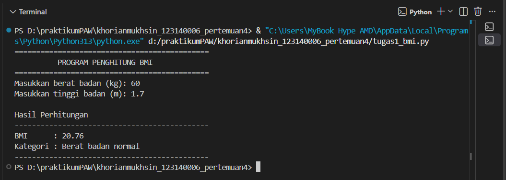
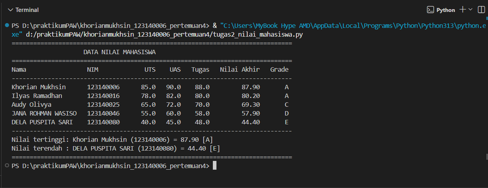
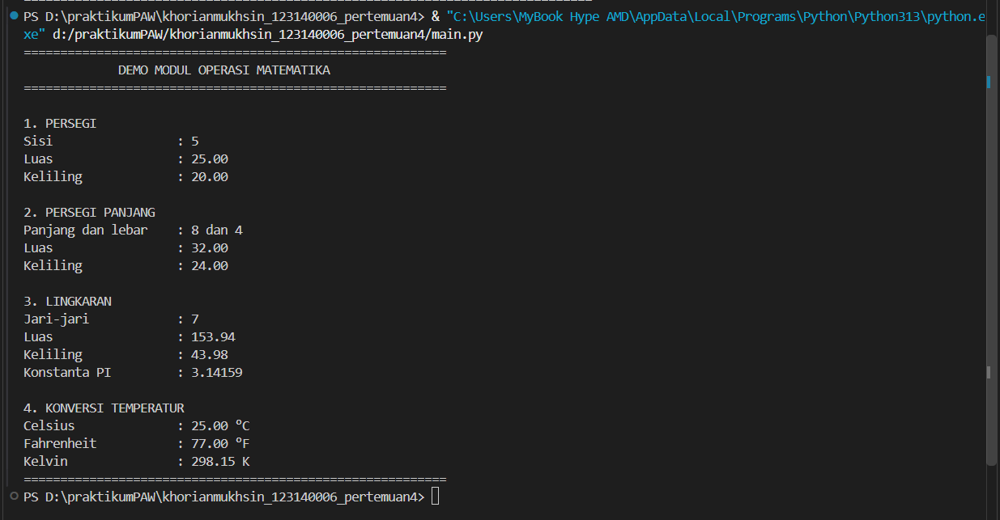

# Tugas Praktikum Pengembangan Aplikasi Web — Pertemuan 4

## Identitas Mahasiswa
- **Nama:** Khorian Mukhsin
- **NIM:** 123140006
- **Program Studi:** Teknik Informatika

## Deskripsi Program

### 1. `tugas1_bmi.py` — Penghitung BMI
Program meminta input berat badan dalam kilogram dan tinggi badan dalam meter. Program menghitung BMI dengan rumus `berat / (tinggi * tinggi)`, lalu menggunakan `if-elif-else` untuk menentukan kategori BMI. Hasil ditampilkan dengan dua angka di belakang koma. Program juga memeriksa agar berat dan tinggi bernilai positif serta menangani input nonangka.

### 2. `tugas2_nilai_mahasiswa.py` — Pengelolaan Nilai Mahasiswa
Program menyimpan lima data mahasiswa dalam list berisi dictionary. Nilai akhir dihitung menggunakan bobot UTS 30%, UAS 40%, dan tugas 30%. Fungsi `tentukan_grade()` mengelompokkan nilai ke grade A–E. Seluruh data ditampilkan dalam tabel, kemudian program mencari mahasiswa dengan nilai akhir tertinggi dan terendah.

### 3. `math_operations.py` dan `main.py` — Modul Matematika
`math_operations.py` merupakan modul kustom yang berisi konstanta `PI`, fungsi luas dan keliling persegi, persegi panjang, lingkaran, serta konversi Celsius ke Fahrenheit dan Kelvin. `main.py` menguji seluruh fungsi tersebut. Contoh impor yang digunakan:
- `import math_operations`
- `from math_operations import ...`

## Struktur Folder

```text
KhorianMukhsin_123140006_pertemuan4/
├── .gitignore
├── README.md
├── tugas1_bmi.py
├── tugas2_nilai_mahasiswa.py
├── math_operations.py
├── main.py
└── screenshots/
    ├── soal1_bmi.png
    ├── soal2_nilai_mahasiswa.png
    └── soal3_modul_matematika.png
```

## Cara Menjalankan

Pastikan Python 3 sudah terpasang. Buka terminal pada folder project, kemudian jalankan:

```bash
python tugas1_bmi.py
python tugas2_nilai_mahasiswa.py
python main.py
```

Jika perintah `python` tidak dikenali di Windows, coba gunakan `py`:

```bash
py tugas1_bmi.py
py tugas2_nilai_mahasiswa.py
py main.py
```

Saat menjalankan program BMI, masukkan berat dalam kg dan tinggi dalam meter. Contoh pengujian: berat `65` dan tinggi `1.70`.

## Bukti Hasil Eksekusi

Screenshot berikut berisi keluaran dari program yang telah dijalankan.

### Soal 1 — Program Penghitung BMI


### Soal 2 — Pengelolaan Data Nilai Mahasiswa


### Soal 3 — Modul Matematika


## Catatan
- Semua fungsi pada modul matematika memiliki docstring yang menjelaskan parameter dan nilai kembaliannya.
- Kode menggunakan indentasi empat spasi dan penamaan variabel/fungsi `snake_case`.
