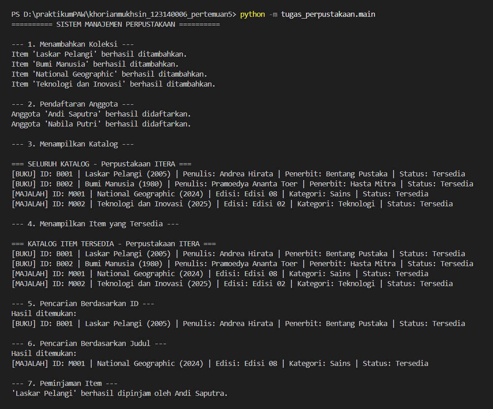
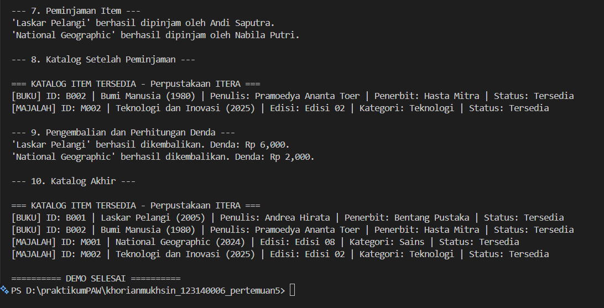

# Praktikum Pengembangan Aplikasi Web — Pertemuan 05
## Python Object-Oriented Programming (OOP)

### Identitas Mahasiswa
- **Nama:** Khorian Mukhsin
- **NIM:** 123140006
- **Kelas Praktikum:** RB

## Deskripsi
Repositori ini berisi latihan konsep Python OOP dan tugas berupa **Sistem Manajemen Perpustakaan Sederhana**. Program dibuat menggunakan data contoh yang sudah ditentukan di dalam kode, sehingga saat dijalankan tidak meminta input dari pengguna.

### Penerapan Konsep OOP pada Tugas
1. **Class dan Object:** `LibraryItem`, `Book`, `Magazine`, `Member`, dan `Library` merupakan class; objek buku, majalah, anggota, dan perpustakaan dibuat di `main.py`.
2. **Inheritance:** `Book` dan `Magazine` mewarisi `LibraryItem`.
3. **Abstraction:** `LibraryItem` merupakan abstract class dengan abstract method `get_detail()` dan `hitung_denda()`.
4. **Encapsulation:** `Library` melindungi koleksi, daftar anggota, dan data peminjaman dengan atribut private (`__koleksi`, `__anggota`, `__peminjaman`). `LibraryItem` juga melindungi status peminjaman melalui `__is_dipinjam`.
5. **Property:** `LibraryItem` menyediakan property `item_id`, `judul`, `tahun_terbit`, dan `is_dipinjam` untuk akses data secara terkontrol.
6. **Polymorphism:** `Book` dan `Magazine` mengimplementasikan `get_detail()` dan `hitung_denda()` dengan perilaku berbeda. `Library.tampilkan_katalog()` memanggil `get_detail()` tanpa perlu memeriksa tipe subclass.
7. **Constructor dan `self`:** Setiap objek menginisialisasi atribut melalui `__init__` dan mengakses instance melalui `self`.

## Struktur Folder
```text
khorian_mukhsin_123140006_pertemuan5/
├── latihan/
│   ├── 01_everything_is_object.py
│   ├── 01_procedural_vs_oop.py
│   ├── 02_class_object.py
│   ├── 03_inheritance.py
│   ├── 04_encapsulation.py
│   ├── 05_polymorphism.py
│   └── 06_abstract_class.py
├── tugas_perpustakaan/
│   ├── __init__.py
│   ├── library_item.py
│   ├── member.py
│   ├── library.py
│   └── main.py
├── screenshots/
│   ├── 01_penambahan_dan_pendaftaran.png
│   ├── 02_katalog_dan_pencarian.png
│   ├── 03_peminjaman_pengembalian.png
│   └── 04_hasil_akhir.png
├── README.md
└── .gitignore
```

## Persyaratan
- Python 3.10 atau lebih baru.
- Visual Studio Code atau editor Python lain.
- Tidak membutuhkan library eksternal.

## Cara Menjalankan
Buka terminal di folder utama proyek, lalu jalankan:

```bash
python -m tugas_perpustakaan.main
```

Untuk menjalankan salah satu latihan, misalnya:

```bash
python latihan/01_everything_is_object.py
```

## Fitur Sistem Perpustakaan
- Menambahkan buku dan majalah ke koleksi.
- Mendaftarkan anggota perpustakaan.
- Menampilkan seluruh katalog dan item yang tersedia.
- Mencari item berdasarkan ID atau judul.
- Memproses peminjaman dan pengembalian.
- Menghitung denda keterlambatan sesuai jenis item.
- Menampilkan status ketersediaan koleksi.

## Screenshot Output
Folder `screenshots/` disediakan untuk menaruh screenshot hasil eksekusi program.





## Catatan Pengujian
Program utama menggunakan data contoh tetap dan tidak meminta input manual. Data hanya disimpan selama program berjalan; belum menggunakan database atau penyimpanan permanen.
